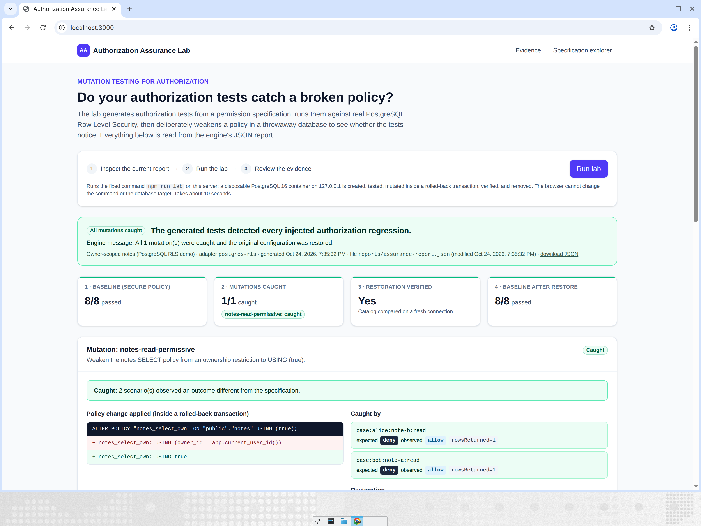
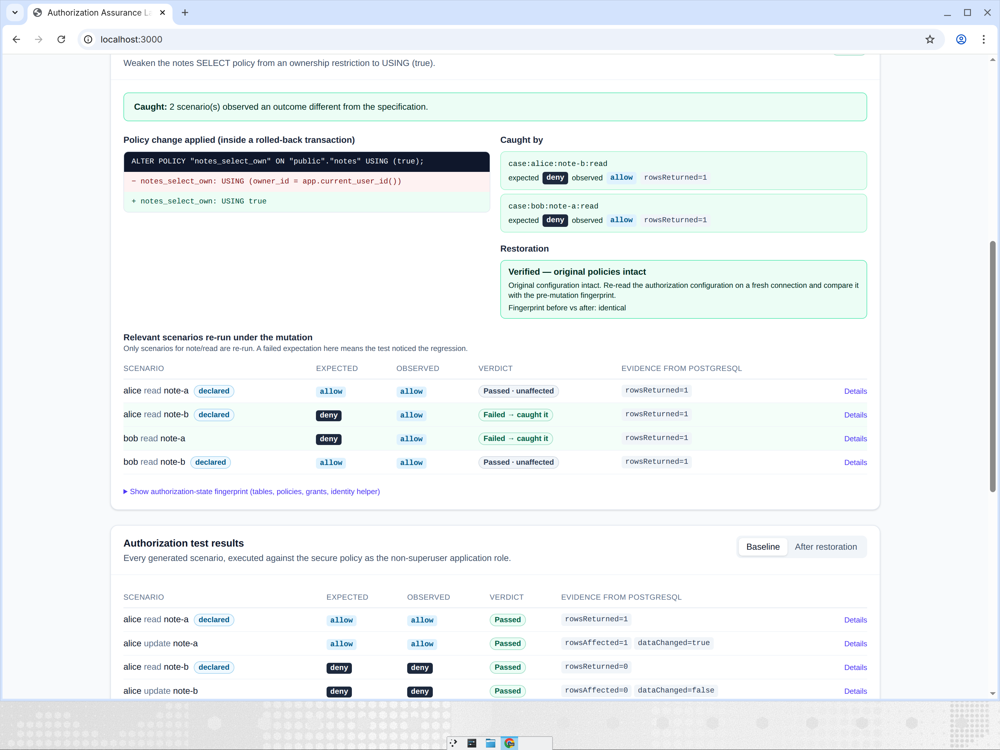
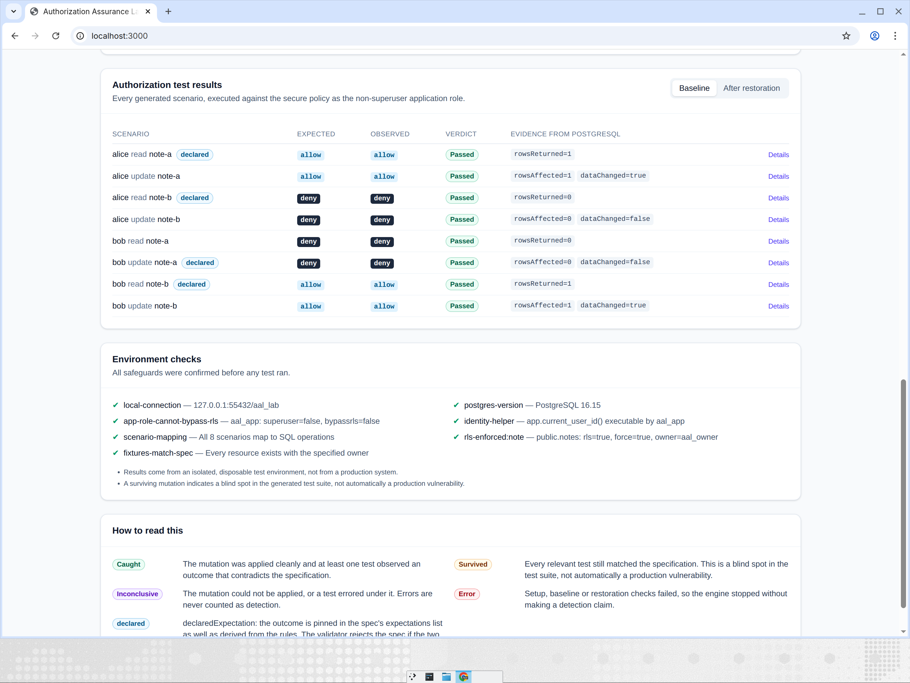
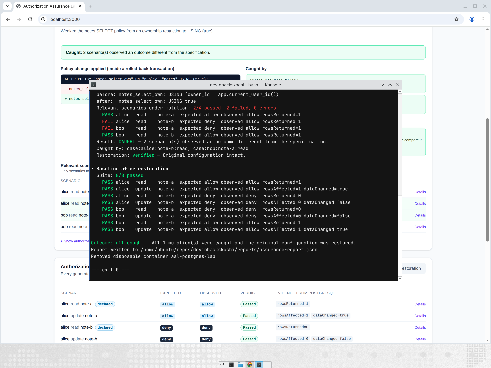

# Authorization Assurance Lab

**Do your authorization tests notice when a policy breaks?** This tool writes authorization tests for you, runs them against real PostgreSQL Row Level Security (RLS), deliberately *breaks* one policy inside a disposable test database, and measures whether your tests catch the regression — with evidence, not guesses.



---

## What this project does (plain language)

**Authorization** answers "who is allowed to do what?" — e.g. *Alice may read her own notes but not Bob's.* Most teams declare those rules once (an RLS policy, a middleware check) and then hope tests would notice if the rule weakened. This lab makes that measurable.

- **Alice and Bob each have private notes.** A permission specification declares the rules (see the one worked example in `examples/postgres-notes/`).
- The engine **generates deterministic test scenarios** from those rules: Alice reads her note (allow), Alice reads Bob's note (deny), Bob edits Alice's note (deny), etc.
- It **runs the baseline suite** against a fresh, disposable PostgreSQL 16 container with real RLS policies — every test must pass before anything is mutated.
- It then **injects a controlled mutation**: `ALTER POLICY notes_select_own USING (true)` — the ownership check is replaced by "everyone can read everything" inside a transaction that is always rolled back.
- It re-runs the affected tests. If any of them observe Bob's note being returned to Alice — which is exactly what the broken policy now allows — the mutation is **caught**.

### Result vocabulary

| Term | Meaning |
|---|---|
| **Caught** | The mutation was applied cleanly and at least one test observed an outcome that contradicts the specification. |
| **Survived** | Every relevant test still matched the spec — your test suite has a **blind spot** (not automatically a production vulnerability). |
| **Inconclusive** | The mutation could not be applied, or a test errored under it. Errors are never counted as detection. |
| **Error** | Setup, baseline or restoration failed, so the run stopped without making a detection claim. |
| **Restoration verified** | The authorization configuration after rollback was re-read on a fresh connection and is identical to the pre-mutation fingerprint. |
| **declared** | The scenario's expected outcome is pinned in the spec's `expectations` list as well as derived from rules; the validator rejects the spec if they disagree. |



*Above: the exact SQL applied, the two cross-user reads that detected it (`rowsReturned=1` where 0 was expected), and the restoration check.*



---

## Quick start (from a fresh clone)

**Prerequisites:** Git · Node.js 22+ and npm · Docker installed **and running**. Nothing else — no Supabase CLI, no `psql`; the database is a disposable Docker container the tool manages itself.

```bash
git clone https://github.com/MohammedRoshanT/devinhackskochi.git
cd devinhackskochi
npm install          # ~30s: installs dependencies

npm run dev          # starts the dashboard
```

Open **http://localhost:3000** and click **Run lab**. The server runs the fixed command `npm run lab` for you (the browser cannot change the command or the database target); the run takes ~10–20 seconds and the report then appears on the page.

Windows PowerShell: the commands are identical — run them in PowerShell inside the project folder. WSL2 is also fine as long as Docker is reachable from it.

Or skip the dashboard entirely and run everything in the terminal:

```bash
npm run lab          # full pipeline: container → baseline → mutation → restore → report
npm run validate     # same run, prints VALIDATION PASSED/FAILED (meant for CI/hooks)
npm test             # 55 unit tests (no Docker needed)
npm run test:integration   # 9 tests against a real disposable container (needs Docker)
```



*Actual terminal output: the mutation was caught by the two cross-user read tests, restoration was verified, and the baseline passed again — exit code 0.*

### Stopping and cleanup

- Stop the dashboard with `Ctrl+C`.
- `npm run lab`/`validate` always removes their container automatically. If you started one manually with `npm run db:start`, remove it with `npm run db:stop`.

### Troubleshooting

| Symptom | Fix |
|---|---|
| `Cannot connect to the Docker daemon` / container won't start | Start Docker Desktop (Windows/macOS) or `sudo systemctl start docker` (Linux), then retry. |
| `node`/`npm` not found | Install Node.js 22+ ([nodejs.org](https://nodejs.org)) or activate your version manager (`nvm use 22`). |
| Port 3000 already in use | Stop the other process or run `npm run dev -- --port 3001`. |
| Port 55432 in use | Another `aal-postgres-lab` container may be running: `docker rm -f aal-postgres-lab`. |
| Dashboard says "No report yet" | Click **Run lab** or run `npm run lab` once; the page reads `reports/assurance-report.json`. |
| Tests failing | Run `npm test` first (no Docker). `npm run test:integration` needs Docker running. |

---

## How a run works

`npm run lab` executes this lifecycle every time:

1. **Environment** — a disposable `postgres:16-alpine` container on `127.0.0.1:55432` (auto-removed). Safeguards are checked first: the app role `aal_app` is non-superuser `NOBYPASSRLS`, the table owner `aal_owner` has `FORCE RLS`, and connections to any non-local host are refused in code.
2. **Baseline** — all 8 generated scenarios run as `aal_app` as a specific test user (identity is a PostgreSQL session setting, `app.current_user_id`). Denied SELECTs are observed as **0 rows**, denied UPDATEs as `rowsAffected=0, dataChanged=false`. The run aborts if the secure baseline doesn't pass.
3. **Mutation** — inside one rolled-back transaction: `ALTER POLICY … USING (true)`, then the relevant scenarios re-run and observe the uncommitted DDL.
4. **Classification** — caught / survived / inconclusive per mutation, from real evidence only.
5. **Restoration** — the transaction rolls back; a fingerprint of policies, grants, table settings and the identity helper is re-read on a fresh connection and must equal the pre-mutation fingerprint.
6. **Baseline again** — the suite re-runs to confirm the original behaviour is intact.
7. **Report** — structured JSON at `reports/assurance-report.json`; the dashboard renders exactly what the engine wrote.

### Real report (from the run above)

```json
{
  "outcome": { "status": "all-caught" },
  "baseline": { "total": 8, "passed": 8 },
  "mutations": [{ "status": "caught",
    "caughtBy": ["case:alice:note-b:read", "case:bob:note-a:read"],
    "restoration": { "verified": true } }],
  "baselineAfterRestore": { "total": 8, "passed": 8 }
}
```

---

## Command reference

| Command | What it does |
|---|---|
| `npm run dev` | Dashboard dev server on :3000 |
| `npm run build` / `npm start` | Production build / server |
| `npm run lab` | Full mutation-testing run (exit 0 caught / 2 survived / 1 error) |
| `npm run validate` | Same run + `VALIDATION PASSED/FAILED` banner; same exit codes |
| `npm test` / `npm run test:integration` | Unit tests / real-container tests |
| `npm run typecheck` · `lint` · `check` | TypeScript, ESLint (0 warnings), everything |
| `npm run db:start` · `db:init` · `db:stop` | Manually manage the disposable DB for inspection |
| `npm run hooks:install` | Optional pre-push hook (below) |

`lab`, `validate` and `db:init` accept `--example <dir>` (project fixture directory), `--config <file>`, `--report <file>`, `--keep-db`, `--reuse-db`. Defaults come from `aal.config.json` when present, else `examples/postgres-notes`.

### Project configuration — `aal.config.json`

```json
{ "version": 1, "adapter": "postgres-rls", "project": { "dir": "examples/postgres-notes" } }
```

`project.dir` points to a directory containing `spec.json`, `schema.sql`, `mutations.json`, `target.json`. `postgres-rls` is the only adapter value today; unknown adapters **and** unknown fields are rejected — there is deliberately no repository-URL field. The tool tests a checked-out local project against a local disposable database, nothing else.

### Optional pre-push hook

```bash
npm run hooks:install   # copies scripts/git-hooks/pre-push → .git/hooks/ (this repo only)
```

The hook runs `npm run validate` and aborts the push on failure. It refuses to overwrite an existing foreign hook; delete `.git/hooks/pre-push` to remove it. Nothing global is changed.

---

## Architecture

- **`src/core/`** — framework-independent engine: spec schema/validation (`rules/`), deterministic scenario generation (`generation/`), the mutation campaign + `AuthorizationAdapter` interface + report models (`mutation/`, `models/`). No Node, React, `pg` or adapter imports allowed (ESLint-enforced).
- **`src/adapters/postgres/`** — the one implemented adapter: Docker lifecycle, fixture roles/RLS, scenario execution, transactional mutation, restoration fingerprint.
- **`src/cli/`** — `lab`, `validate` and `db` entrypoints sharing `run.ts`; config loading (`config.ts`); report path constant (`paths.ts`).
- **`app/`** — Next.js dashboard: `/` evidence view (reads the real report via `GET /api/report`; `POST /api/lab` spawns the fixed `npm run lab` only — no shell, no user input, `AAL_DISABLE_LAB_RUNS=1` to disable), `/spec` scenario generator UI.
- **`examples/postgres-notes/`** — the fixture: `spec.json`, `schema.sql`, `mutations.json`, `target.json`.
- **`tests/`** — unit tests + Docker integration tests (each suite uses its own container/port).

### The permission specification (excerpt)

```json
{
  "identities": [{ "id": "alice", "roles": ["member"] }, { "id": "bob", "roles": ["member"] }],
  "resources": [{ "id": "note-a", "type": "note", "ownerId": "alice" }, { "id": "note-b", "type": "note", "ownerId": "bob" }],
  "rules": [
    { "id": "members-manage-own-notes", "effect": "allow", "subject": { "kind": "role", "role": "member" },
      "resource": { "kind": "type", "type": "note" }, "actions": ["read", "update"], "ownership": "owner" },
    { "id": "members-no-cross-user-access", "effect": "deny", "subject": { "kind": "role", "role": "member" },
      "resource": { "kind": "type", "type": "note" }, "actions": ["read", "update"], "ownership": "non-owner" }
  ],
  "expectations": [{ "identityId": "alice", "resourceId": "note-b", "action": "read", "outcome": "deny" }]
}
```

Rules are evaluated with **default-deny** semantics; an allow and a deny matching the same case is a validation error (no precedence guessing); `ownership` is `any` / `owner` / `non-owner`. Invalid specs are rejected with exact field errors.

## Safety and limits

- **Disposable-local only.** Connections to non-127.0.0.1/localhost hosts are refused in code; the container is ephemeral; mutations run in rolled-back transactions. Nothing here can target a remote or production database.
- **Current scope:** one adapter (`postgres-rls`), one mutation operator (`permissive-condition` on the notes SELECT policy), SELECT and UPDATE mapped. It does **not** scan arbitrary GitHub repositories, HTTP APIs, Supabase projects or other frameworks — the `AuthorizationAdapter` interface exists so more adapters can be added.
- **Semantics:** a *survived* mutation means a test-suite blind spot, not automatically a production vulnerability; results come from an isolated test environment, not a real deployment.
- Test identity via `app.current_user_id` is a **test adapter mechanism**, not a claim about any real authentication integration.
- The dashboard is local-only (no authentication); run state lives in server memory.
